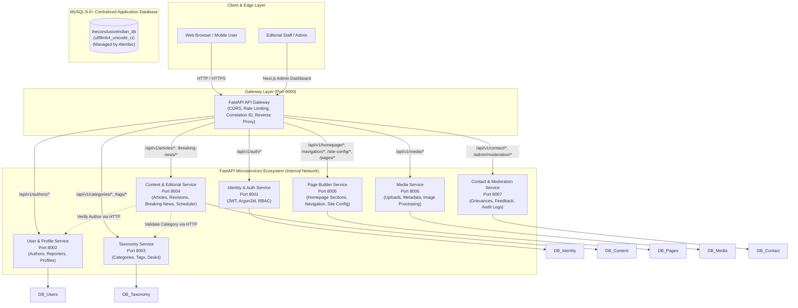

# The Conclusive Indian (द कन्क्लूसिव इंडियन)
## Enterprise Microservices Architecture & Implementation Blueprint

---

## 1. Executive Summary & Architectural Vision

**The Conclusive Indian** is a high-performance, trusted Hindi digital news portal with national reach. To achieve high availability, clear domain ownership, independent scalability, and strict security, the platform is transitioning from a static/mock-backed Next.js application into a production-ready **Microservices-Based Platform**.

### Core Architecture Tenets:
1. **Decoupled Frontend & Backend**: The Next.js 16+ frontend lives exclusively in `frontend/`, and independent FastAPI services live inside `backend/services/`.
2. **True Domain Isolation**: Each microservice maintains complete ownership of its domain models and dedicated MySQL database. No shared tables or cross-database SQL joins.
3. **Unified API Gateway**: A resilient gateway (`backend/gateway`) acts as the single public entry point (`/api/v1/*`), handling reverse proxy routing, CORS, rate limiting, request tracing (`X-Correlation-ID`), and standardized error normalization.
4. **Fine-Grained RBAC**: Cryptographically secure authentication (Argon2id + JWT) with a deterministic permission matrix enforcing access across Super Admin, Editor-in-Chief, Editor, Author, Reporter, Moderator, and Reader roles.
5. **Dynamic Page Builder & Content Engine**: 100% of homepage sections, breaking news items, navigation links, policy texts, and site settings are editable via an Admin Dashboard without requiring code redeployments.
6. **Graceful Degradation**: The frontend includes an intelligent service layer that consumes live microservice endpoints while maintaining instant fallback capability for offline or demo resilience.

---

## 2. System Topology & Network Architecture

---

## 3. Frontend Inventory & Editable Element Mapping

Every component in `frontend/src/` has been inventoried and mapped to its owning backend service:

| Frontend Component / Route | Current Data Source | Owning Backend Microservice | Target API Endpoint |
|---|---|---|---|
| `SiteHeader.tsx` (Logo, Nav, Social) | `SITE_CONFIG` | Page Builder Service | `GET /api/v1/site-config`, `GET /api/v1/navigation` |
| `BreakingNewsTicker.tsx` | `MOCK_BREAKING_NEWS` | Content & Editorial Service | `GET /api/v1/breaking-news` |
| `TopUtilityBar.tsx` (Date, Lang, Trend) | Hardcoded / Config | Page Builder Service | `GET /api/v1/site-config` |
| `FeaturedStoryLead.tsx` & `FeaturedNewsGrid.tsx` | `MOCK_ARTICLES` | Content & Editorial Service | `GET /api/v1/articles/featured` |
| `LatestNewsList.tsx` | `MOCK_ARTICLES` | Content & Editorial Service | `GET /api/v1/articles?sort=latest` |
| `CategoryNewsSection.tsx` | `MOCK_ARTICLES` | Content & Editorial Service | `GET /api/v1/articles?category={slug}` |
| `TrendingNews.tsx` | `MOCK_ARTICLES` | Content & Editorial Service | `GET /api/v1/articles/trending` |
| `VideoNewsSection.tsx` | `MOCK_VIDEOS` | Content & Editorial Service | `GET /api/v1/multimedia/videos` |
| `PhotoGallerySection.tsx` | `MOCK_PHOTO_STORIES` | Content & Editorial Service | `GET /api/v1/multimedia/photos` |
| `OpinionSection.tsx` | `MOCK_OPINIONS` | Content & Editorial Service | `GET /api/v1/multimedia/opinions` |
| `SiteFooter.tsx` (Links, Grievance, Legal) | `SITE_CONFIG` | Page Builder Service | `GET /api/v1/site-config`, `GET /api/v1/navigation/footer` |
| `PolicyHeader.tsx` & Policy Pages (`/editorial-policy`, `/privacy-policy`, etc.) | Static text / SiteConfig | Page Builder Service | `GET /api/v1/pages/{slug}` |
| `ContactForm.tsx` & `/contact-us`, `/grievance-redressal` | Local form | Contact & Moderation Service | `POST /api/v1/contact/feedback` |
| `/search` Page | `lib/search.ts` | Content & Editorial Service | `GET /api/v1/articles/search?q={query}` |
| `/author/[slug]` Page | `MOCK_AUTHORS` | User & Profile Service | `GET /api/v1/authors/{slug}` |
| `/category/[slug]` Page | `SITE_CONFIG.categories` | Taxonomy Service | `GET /api/v1/categories/{slug}` |
| `/tag/[slug]` Page | Mock tag filtering | Taxonomy & Content Service | `GET /api/v1/articles?tag={slug}` |
| `/admin/*` Dashboard | **New Implementation** | Gateway + All Services | Full Admin Management Suite |

---

## 4. Service Boundaries & Responsibilities

### 1. API Gateway (`backend/gateway`)
- Port: `8000`
- Reverse proxy routing to internal services
- Standardized response formatting and error handling
- Global CORS headers (`http://localhost:3000`, production domain)
- Correlation ID generation (`X-Correlation-ID`) injected into request headers
- Health check aggregator (`GET /api/v1/health`)
- OpenAPI documentation aggregation

### 2. Identity and Authentication Service (`backend/services/identity-service`)
- Port: `8001`
- Database: `tci_identity_db`
- Password hashing with **Argon2id** (with fallback to bcrypt)
- JWT access tokens (short-lived, e.g. 30 mins) and refresh tokens (7 days)
- Token revocation and blacklisting
- Role assignment and permission resolution
- Audit logging for login attempts and administrative actions

### 3. User and Profile Service (`backend/services/user-service`)
- Port: `8002`
- Database: `tci_users_db`
- Public author profiles (name, Devanagari Hindi name, bio, designation, photo, social handles)
- Reader profile settings and preferences
- Author articles cross-reference via Content Service contracts

### 4. Taxonomy Service (`backend/services/taxonomy-service`)
- Port: `8003`
- Database: `tci_taxonomy_db`
- News categories (Hindi name, English name, slug, description, color, ordering, status)
- Tag management (Hindi & English slugs, usage counts)
- Editorial desks (National, International, Politics, Sports, Entertainment, Business, Tech, State, Agriculture)

### 5. Content and Editorial Service (`backend/services/content-service`)
- Port: `8004`
- Database: `tci_content_db`
- Article lifecycle: `draft` -> `review` -> `scheduled` -> `published` -> `archived`
- Full text content, excerpts, headlines, subheadlines
- Media associations (featured images, captions, credits)
- Breaking news ticker stream (title, category, urgency, timestamp)
- Video stories and photo galleries
- Editorial opinion pieces and columns
- Background scheduled publication worker
- Revision history and editorial notes

### 6. Page Builder & Configuration Service (`backend/services/page-builder-service`)
- Port: `8005`
- Database: `tci_pages_db`
- Dynamic homepage section layout manager (section type, title, display order, visibility, layout variant)
- Navigation link hierarchy (Header main navigation, Top bar quick links, Mobile drawer, Footer columns)
- Site-wide settings (Site name, tagline, logo URL, contact details, social links, compliance officer info, business verification)
- Static policy pages (About Us, Editorial Policy, Grievance Redressal, Fact-Check Policy, Corrections Policy, Cookie Policy, Terms)

### 7. Media Service (`backend/services/media-service`)
- Port: `8006`
- Database: `tci_media_db`
- File upload handling with strict MIME type and magic byte validation (JPEG, PNG, WebP, AVIF)
- Local filesystem storage adapter with clean abstraction for AWS S3 / Cloudflare R2
- Media metadata management (alt text in Hindi/English, caption, photographer credit, dimensions)
- Asset library search and usage tracking

### 8. Contact & Moderation Service (`backend/services/contact-moderation-service`)
- Port: `8007`
- Database: `tci_contact_db`
- Feedback and contact submissions
- Grievance redressal tickets with tracking ID and SLA monitoring
- Editorial correction requests
- Moderation queue and administrative response logging

---

## 5. Relational Database Design (MySQL 8.0+)

Each microservice possesses its own isolated database with `utf8mb4` encoding and `utf8mb4_unicode_ci` collation to natively support Hindi Devanagari script, conjuncts, matras, and search indexing.

### Database Credentials & Least Privilege
- Dedicated user and password per database
- Root user utilized strictly for development setup scripts

---

## 6. Authentication, Authorization & RBAC Matrix

| Role | Article CRUD | Publish / Schedule | Manage Taxonomy | Manage Page Layout | Manage Media | View Grievances | Manage Users & Roles |
|---|:---:|:---:|:---:|:---:|:---:|:---:|:---:|
| **Super Admin** | Full | Yes | Full | Full | Full | Full | Full |
| **Editor-in-Chief** | Full | Yes | Full | Full | Full | Full | Read Only |
| **Editor** | Full | Yes | Create/Edit | Edit Sections | Full | View/Resolve | None |
| **Author** | Own Articles | Submit Review | View Only | None | Upload Own | None | None |
| **Reporter** | Own Drafts | Submit Review | View Only | None | Upload Own | None | None |
| **Moderator** | None | None | None | None | None | Full | None |
| **Reader** | Read Only | None | None | None | None | Submit Only | None |

---

## 7. Next.js Admin Dashboard Architecture

Inside `frontend/src/app/admin/`:
- `/admin/login`: Secure credential authentication
- `/admin/dashboard`: Metrics overview (total published articles, pending reviews, active categories, recent feedback)
- `/admin/articles`: Article listing with status badges, search, filter by author/category, and pagination
- `/admin/articles/create` & `/admin/articles/[id]/edit`: Full editorial article composer with Hindi headline, slug auto-generation, category selection, tag manager, excerpt, rich content, status selector, and scheduled date picker
- `/admin/categories`: Category management (Hindi name, English name, slug, ordering, color)
- `/admin/breaking-news`: Live ticker management (add urgent alerts, toggle active status)
- `/admin/page-builder`: Drag/toggle homepage sections and layout order
- `/admin/site-settings`: Global branding, contact details, social URLs, compliance info
- `/admin/contact-feedback`: Grievance and feedback submission queue with status filters
- `/admin/media`: Media library uploader and asset picker

---

## 8. Phased Implementation Roadmap

1. **Phase 1: Architecture & Inventory** (Completed by this document and specifications)
2. **Phase 2: Backend Infrastructure & API Gateway** (Gateway, Docker Compose, shared contracts, MySQL init)
3. **Phase 3: Identity & Authentication Service** (Argon2id, JWT, User & Role seeds)
4. **Phase 4: Core Taxonomy & Editorial Services** (Categories, Tags, Articles, Breaking News, Scheduler)
5. **Phase 5: Page Builder & Site Configuration Service** (Homepage sections, Site settings, Static pages)
6. **Phase 6: Media & Contact/Moderation Services** (Uploads, Feedback, Grievances)
7. **Phase 7: Comprehensive Next.js Admin Dashboard** (Admin UI, JWT cookie auth, CRUD interfaces)
8. **Phase 8: Frontend Live API Integration & Fallback Verification**
9. **Phase 9: End-to-End Automated Testing & Quality Assurance**
