# Centralized Database Architecture & Schema Specification (MySQL 8.0+)

**The Conclusive Indian (द कन्क्लूसिव इंडियन)** uses **one centralized MySQL application database** (`u738606952_theconclusive`) for the entire platform.

All tables are strictly configured with:
- **Character Set:** `utf8mb4`
- **Collation:** `utf8mb4_unicode_ci` (guaranteeing comprehensive Devanagari Hindi Unicode sort, index, and full-text search fidelity)
- **Engine:** `InnoDB` (ACID transaction reliability, foreign key constraint enforcement, row-level locking)
- **Migration Tool:** `Alembic` (asynchronous SQLAlchemy engine)

---

## 1. Single Database & Service Ownership Model

The system operates as a **modular microservice architecture over a single application database**. Each table is assigned to exactly **one authoritative owning service** responsible for writes and data lifecycle:

| Owning Service | Service Port | Authoritative Tables (Exclusive Write Access) | Domain Responsibility |
|:---|:---|:---|:---|
| **Identity Service** | 8001 | `users`, `roles`, `user_roles`, `revoked_tokens` | Authentication, RBAC, JWT revocation |
| **User Service** | 8002 | `authors` | Editorial bios, credentials, columnist profiles |
| **Taxonomy Service** | 8003 | `categories`, `tags` | News taxonomy, 12 Hindi categories, trending tag counts |
| **Content Service** | 8004 | `articles`, `article_tags`, `breaking_news`, `video_stories`, `photo_stories`, `opinion_articles` | Core journalism, article lifecycle, breaking ticker, multimedia bulletins |
| **Page Builder Service** | 8005 | `homepage_sections`, `site_settings`, `static_pages`, `navigation_items` | Homepage modular layout order, global branding, statutory policies, navigation menus |
| **Media Service** | 8006 | `media_assets` | File uploads, mime validation, asset metadata, disk/S3 links |
| **Contact Moderation Service** | 8007 | `contact_submissions`, `audit_logs` | Grievance redressal (IT Rules 2021), public contact inquiries, immutable security audit trail |

---

## 2. Complete Entity-Relationship (ER) Diagram

```mermaid
erDiagram
    users ||--o{ user_roles : "assigned"
    roles ||--o{ user_roles : "grants"
    revoked_tokens {
        string jti PK
        datetime revoked_at
    }

    categories ||--o{ articles : "categorizes"
    categories ||--o{ video_stories : "categorizes"
    categories ||--o{ photo_stories : "categorizes"

    authors ||--o{ articles : "authors"
    authors ||--o{ opinion_articles : "writes"

    articles ||--o{ article_tags : "tagged_with"
    tags ||--o{ article_tags : "tags"

    articles {
        string id PK
        string title
        string english_title
        string slug UK
        text excerpt
        longtext content
        string featured_image
        string image_alt
        string image_caption
        string image_credit
        string category_slug FK
        string author_slug FK
        string status
        boolean is_breaking
        boolean is_featured
        boolean is_trending
        int view_count
        int read_time_minutes
        datetime published_at
        datetime scheduled_at
        datetime created_at
        datetime updated_at
    }

    article_tags {
        string article_id PK, FK
        string tag_id PK, FK
    }

    tags {
        string id PK
        string name UK
        string slug UK
        int usage_count
        boolean is_trending
        datetime created_at
    }

    categories {
        string id PK
        string name
        string english_name
        string slug UK
        text description
        string color
        int display_order
        boolean is_active
        datetime created_at
        datetime updated_at
    }

    authors {
        string id PK
        string name
        string english_name
        string slug UK
        string role
        text bio
        string avatar
        string twitter
        string email
        datetime created_at
        datetime updated_at
    }

    breaking_news {
        string id PK
        string title
        string slug
        string category
        string timestamp_text
        boolean is_urgent
        boolean is_active
        datetime created_at
    }

    video_stories {
        string id PK
        string title
        string slug UK
        string thumbnail
        string duration
        string category_slug FK
        string category_name
        string youtube_id
        string youtube_url
        boolean is_featured
        string guest
        string channel_name
        text description
        datetime published_at
    }

    photo_stories {
        string id PK
        string title
        string slug UK
        string thumbnail
        int photo_count
        string category_slug FK
        string category_name
        datetime published_at
    }

    opinion_articles {
        string id PK
        string title
        string slug UK
        text excerpt
        string author_slug FK
        string author_name
        string author_role
        string author_avatar
        int read_time_minutes
        datetime published_at
    }

    homepage_sections {
        string id PK
        string section_type
        string title
        int display_order
        boolean is_enabled
        text config_json
    }

    site_settings {
        string key PK
        longtext value_json
        datetime updated_at
    }

    static_pages {
        string slug PK
        string title
        string hindi_title
        longtext content_markdown
        text meta_description
        datetime updated_at
    }

    navigation_items {
        string id PK
        string menu_location
        string label
        string href
        int display_order
        boolean is_active
    }

    media_assets {
        string id PK
        string filename
        string original_filename
        string mime_type
        int file_size_bytes
        string storage_path
        string public_url
        string alt_text
        string caption
        string credit
        datetime created_at
    }

    contact_submissions {
        string id PK
        string ticket_id UK
        string full_name
        string email
        string phone
        string category
        string subject
        longtext message
        string status
        text internal_notes
        datetime created_at
        datetime resolved_at
    }

    audit_logs {
        bigint id PK
        string user_id
        string user_email
        string action
        string resource_type
        string resource_id
        longtext details_json
        string ip_address
        string user_agent
        datetime created_at
    }
```

---

## 3. Data Dictionary & Table Specifications

### 3.1 `roles`
Stores standard RBAC roles across the publishing workflow.
- `name` VARCHAR(50) PRIMARY KEY (`super_admin`, `editor_in_chief`, `editor`, `author`, `reporter`, `moderator`, `reader`)
- `description` VARCHAR(255) NULL
- `created_at` DATETIME NOT NULL DEFAULT CURRENT_TIMESTAMP

### 3.2 `users`
Authenticated administrative and editorial users.
- `id` VARCHAR(36) PRIMARY KEY (UUID v4)
- `email` VARCHAR(255) UNIQUE NOT NULL
- `hashed_password` VARCHAR(255) NOT NULL (Bcrypt 12-round salt)
- `full_name` VARCHAR(255) NOT NULL
- `is_active` TINYINT(1) NOT NULL DEFAULT 1
- `created_at`, `updated_at` DATETIME NOT NULL

### 3.3 `user_roles`
Junction table mapping users to permissions.
- `user_id` VARCHAR(36) NOT NULL (FK -> `users.id` ON DELETE CASCADE)
- `role_name` VARCHAR(50) NOT NULL (FK -> `roles.name` ON DELETE CASCADE)
- PRIMARY KEY (`user_id`, `role_name`)

### 3.4 `revoked_tokens`
Cryptographic token revocation blacklist for immediate session invalidation on logout.
- `jti` VARCHAR(255) PRIMARY KEY
- `revoked_at` DATETIME NOT NULL DEFAULT CURRENT_TIMESTAMP

### 3.5 `authors`
Editorial board and journalist profiles.
- `id` VARCHAR(50) PRIMARY KEY
- `name` VARCHAR(255) NOT NULL (Hindi display name, e.g. 'राघवेंद्र शुक्ल')
- `english_name` VARCHAR(255) NULL
- `slug` VARCHAR(255) UNIQUE NOT NULL (e.g. 'raghavendra-shukla')
- `role` VARCHAR(255) NULL (e.g. 'वरिष्ठ पर्यावरण संवाददाता')
- `bio` TEXT NULL
- `avatar` VARCHAR(1000) NULL
- `twitter` VARCHAR(255) NULL
- `email` VARCHAR(255) NULL
- `created_at`, `updated_at` DATETIME NOT NULL

### 3.6 `categories`
Taxonomic categorization for news stories.
- `id` VARCHAR(50) PRIMARY KEY (e.g. 'cat-politics')
- `name` VARCHAR(100) NOT NULL (e.g. 'राजनीति')
- `english_name` VARCHAR(100) NOT NULL (e.g. 'Politics')
- `slug` VARCHAR(100) UNIQUE NOT NULL
- `description` TEXT NULL
- `color` VARCHAR(50) NOT NULL DEFAULT '#1E3A8A'
- `display_order` INT NOT NULL DEFAULT 0
- `is_active` TINYINT(1) NOT NULL DEFAULT 1
- `created_at`, `updated_at` DATETIME NOT NULL

### 3.7 `tags`
Tag taxonomy and trending topics.
- `id` VARCHAR(50) PRIMARY KEY
- `name` VARCHAR(100) UNIQUE NOT NULL (e.g. '#उत्तराखंड_भू_कानून')
- `slug` VARCHAR(100) UNIQUE NOT NULL
- `usage_count` INT NOT NULL DEFAULT 1
- `is_trending` TINYINT(1) NOT NULL DEFAULT 0
- `created_at` DATETIME NOT NULL DEFAULT CURRENT_TIMESTAMP

### 3.8 `articles`
Primary digital journalism publication table.
- `id` VARCHAR(50) PRIMARY KEY
- `title` VARCHAR(500) NOT NULL
- `english_title` VARCHAR(500) NULL
- `slug` VARCHAR(500) UNIQUE NOT NULL
- `excerpt` TEXT NOT NULL
- `content` LONGTEXT NOT NULL
- `featured_image` VARCHAR(1000) NOT NULL
- `image_alt` VARCHAR(500) NOT NULL
- `image_caption` VARCHAR(500) NULL
- `image_credit` VARCHAR(255) NULL
- `category_slug` VARCHAR(100) NOT NULL (FK -> `categories.slug` ON UPDATE CASCADE)
- `author_slug` VARCHAR(100) NOT NULL (FK -> `authors.slug` ON UPDATE CASCADE)
- `status` VARCHAR(50) NOT NULL DEFAULT 'published' (`draft`, `review`, `scheduled`, `published`, `archived`)
- `tags_csv` TEXT NULL (denormalized fast read cache)
- `is_breaking` TINYINT(1) NOT NULL DEFAULT 0
- `is_featured` TINYINT(1) NOT NULL DEFAULT 0
- `is_trending` TINYINT(1) NOT NULL DEFAULT 0
- `view_count` INT NOT NULL DEFAULT 100
- `read_time_minutes` INT NOT NULL DEFAULT 4
- `published_at` DATETIME NOT NULL DEFAULT CURRENT_TIMESTAMP
- `scheduled_at` DATETIME NULL
- `created_at`, `updated_at` DATETIME NOT NULL

### 3.9 `article_tags`
Normalized Many-to-Many relational junction between articles and tags.
- `article_id` VARCHAR(50) NOT NULL (FK -> `articles.id` ON DELETE CASCADE)
- `tag_id` VARCHAR(50) NOT NULL (FK -> `tags.id` ON DELETE CASCADE)
- PRIMARY KEY (`article_id`, `tag_id`)
- INDEX (`tag_id`)

### 3.10 `breaking_news`
Live urgent ticker alerts displayed in the masthead.
- `id` VARCHAR(50) PRIMARY KEY
- `title` VARCHAR(500) NOT NULL
- `slug` VARCHAR(500) NOT NULL
- `category` VARCHAR(100) NOT NULL DEFAULT 'देश'
- `timestamp_text` VARCHAR(100) NOT NULL DEFAULT 'अभी-अभी'
- `is_urgent` TINYINT(1) NOT NULL DEFAULT 1
- `is_active` TINYINT(1) NOT NULL DEFAULT 1
- `created_at` DATETIME NOT NULL DEFAULT CURRENT_TIMESTAMP

### 3.11 `video_stories`
Video news bulletins and discussions with YouTube embedding.
- `id` VARCHAR(50) PRIMARY KEY
- `title` VARCHAR(500) NOT NULL
- `slug` VARCHAR(500) UNIQUE NOT NULL
- `thumbnail` VARCHAR(1000) NOT NULL
- `duration` VARCHAR(50) NOT NULL DEFAULT '15:00'
- `category_slug` VARCHAR(100) NOT NULL (FK -> `categories.slug` ON UPDATE CASCADE)
- `youtube_id` VARCHAR(100) NULL
- `youtube_url` VARCHAR(500) NULL
- `is_featured` TINYINT(1) NOT NULL DEFAULT 0
- `guest` VARCHAR(255) NULL
- `channel_name` VARCHAR(255) NOT NULL DEFAULT 'The Conclusive Indian'
- `description` TEXT NULL
- `published_at` DATETIME NOT NULL DEFAULT CURRENT_TIMESTAMP

### 3.12 `photo_stories`
Curated photo journalism stories and galleries.
- `id` VARCHAR(50) PRIMARY KEY
- `title` VARCHAR(500) NOT NULL
- `slug` VARCHAR(500) UNIQUE NOT NULL
- `thumbnail` VARCHAR(1000) NOT NULL
- `photo_count` INT NOT NULL DEFAULT 6
- `category_slug` VARCHAR(100) NOT NULL (FK -> `categories.slug` ON UPDATE CASCADE)
- `published_at` DATETIME NOT NULL DEFAULT CURRENT_TIMESTAMP

### 3.13 `opinion_articles`
Editorial columns and analytical op-eds.
- `id` VARCHAR(50) PRIMARY KEY
- `title` VARCHAR(500) NOT NULL
- `slug` VARCHAR(500) UNIQUE NOT NULL
- `excerpt` TEXT NOT NULL
- `author_slug` VARCHAR(100) NOT NULL (FK -> `authors.slug` ON UPDATE CASCADE)
- `read_time_minutes` INT NOT NULL DEFAULT 5
- `published_at` DATETIME NOT NULL DEFAULT CURRENT_TIMESTAMP

### 3.14 `homepage_sections`
Dynamic page-builder section order, visibility toggle, and component configuration.
- `id` VARCHAR(50) PRIMARY KEY
- `section_type` VARCHAR(50) NOT NULL (`hero`, `latest`, `category`, `videos`, `photos`, `opinion`, `ad_banner`)
- `title` VARCHAR(255) NOT NULL
- `display_order` INT NOT NULL DEFAULT 0
- `is_enabled` TINYINT(1) NOT NULL DEFAULT 1
- `config_json` TEXT NULL

### 3.15 `site_settings`
Key-value store for global site configuration.
- `key` VARCHAR(100) PRIMARY KEY
- `value_json` LONGTEXT NOT NULL
- `updated_at` DATETIME NOT NULL DEFAULT CURRENT_TIMESTAMP ON UPDATE CURRENT_TIMESTAMP

### 3.16 `static_pages`
Statutory and institutional policy pages in Markdown.
- `slug` VARCHAR(100) PRIMARY KEY (`about-us`, `editorial-policy`, `grievance-redressal`, etc.)
- `title` VARCHAR(255) NOT NULL
- `hindi_title` VARCHAR(255) NOT NULL
- `content_markdown` LONGTEXT NOT NULL
- `meta_description` TEXT NULL
- `updated_at` DATETIME NOT NULL DEFAULT CURRENT_TIMESTAMP ON UPDATE CURRENT_TIMESTAMP

### 3.17 `navigation_items`
Header and footer navigation menu links and ordering.
- `id` VARCHAR(50) PRIMARY KEY
- `menu_location` VARCHAR(50) NOT NULL (`header`, `topbar`, `footer_editorial`, `footer_legal`, `footer_corporate`)
- `label` VARCHAR(255) NOT NULL
- `href` VARCHAR(500) NOT NULL
- `display_order` INT NOT NULL DEFAULT 0
- `is_active` TINYINT(1) NOT NULL DEFAULT 1

### 3.18 `media_assets`
Uploaded media file metadata and links.
- `id` VARCHAR(50) PRIMARY KEY
- `filename` VARCHAR(255) NOT NULL
- `original_filename` VARCHAR(255) NOT NULL
- `mime_type` VARCHAR(100) NOT NULL
- `file_size_bytes` INT NOT NULL
- `storage_path` VARCHAR(500) NOT NULL
- `public_url` VARCHAR(500) NOT NULL
- `alt_text` VARCHAR(500) NULL
- `caption` VARCHAR(500) NULL
- `credit` VARCHAR(255) NULL
- `created_at` DATETIME NOT NULL DEFAULT CURRENT_TIMESTAMP

### 3.19 `contact_submissions`
Reader feedback, editorial correction requests, and formal IT Rules 2021 grievances.
- `id` VARCHAR(50) PRIMARY KEY
- `ticket_id` VARCHAR(50) UNIQUE NOT NULL (e.g. 'TCI-20261021-91FD81')
- `full_name` VARCHAR(255) NOT NULL
- `email` VARCHAR(255) NOT NULL
- `phone` VARCHAR(50) NULL
- `category` VARCHAR(50) NOT NULL (`general`, `tip`, `editorial_correction`, `advertise`, `grievance`, `privacy`)
- `subject` VARCHAR(500) NOT NULL
- `message` LONGTEXT NOT NULL
- `status` VARCHAR(50) NOT NULL DEFAULT 'pending' (`pending`, `under_review`, `resolved`, `dismissed`)
- `internal_notes` TEXT NULL
- `created_at` DATETIME NOT NULL DEFAULT CURRENT_TIMESTAMP
- `resolved_at` DATETIME NULL

### 3.20 `audit_logs`
Immutable compliance audit ledger.
- `id` BIGINT AUTO_INCREMENT PRIMARY KEY
- `user_id` VARCHAR(36) NULL
- `user_email` VARCHAR(255) NULL
- `action` VARCHAR(100) NOT NULL
- `resource_type` VARCHAR(100) NOT NULL
- `resource_id` VARCHAR(255) NULL
- `details_json` LONGTEXT NULL
- `ip_address` VARCHAR(45) NULL
- `user_agent` VARCHAR(500) NULL
- `created_at` DATETIME NOT NULL DEFAULT CURRENT_TIMESTAMP
- **Security Triggers:** Protected against `UPDATE` and `DELETE` via database triggers `trg_audit_logs_prevent_update` and `trg_audit_logs_prevent_delete`.
